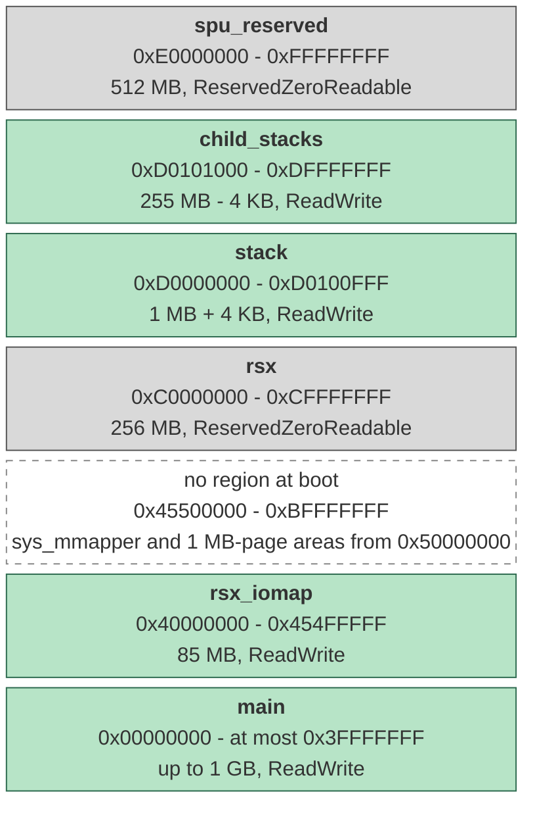
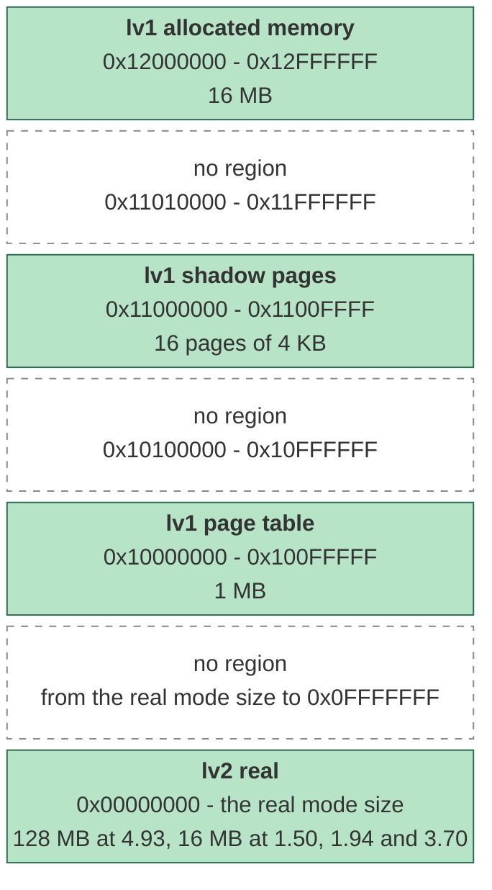
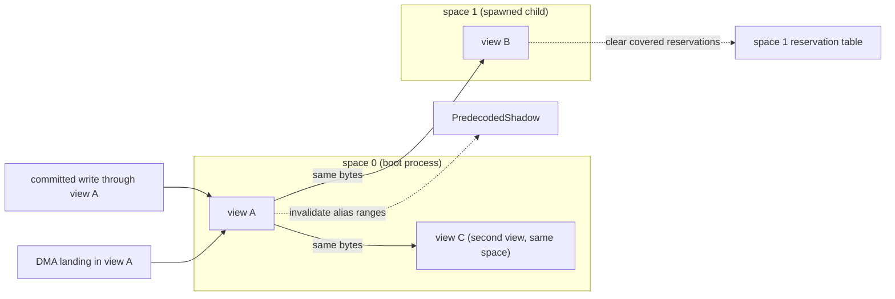
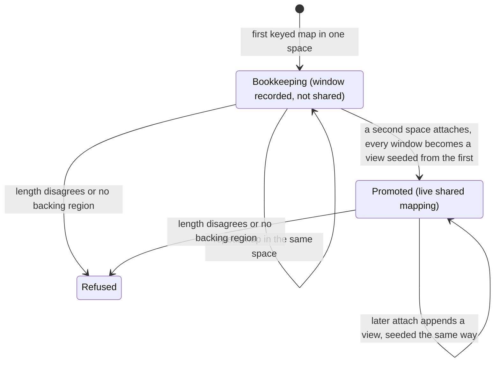

# Guest memory layout

`cellgov_mem::GuestMemory` is a sorted `Vec<Region>` keyed by
region base address. Each `Region` owns a `Vec<u8>` sized to the
region, plus:

- a label;
- a page-size class;
- an access mode.

`containing_region(addr, length)` translates addresses by binary
search. It returns the region entirely containing the range, or
`None` if the access straddles a boundary, falls in an unmapped
gap, or starts below the floor `unmap_below` sets.

Each boot builds its regions in its own layout:

- the title boot, where CellGov serves LV2's system calls itself,
  keys its regions by LV2 virtual address ([Title boot
  layout](#title-boot-layout));
- the kernel boot, where the real LV2 kernel runs under CellGov's
  hypervisor, keys its regions by real address ([Kernel boot
  layout](#kernel-boot-layout)).

## Title boot layout

For a title, the `boot run` driver builds these regions, matching the
canonical PS3 LV2 virtual-address layout. High addresses are at the top.
Green regions are `ReadWrite`, grey regions are
`ReservedZeroReadable` (the default), and the dashed box is a range the
boot leaves without a region.

| Label          | Purpose                                                                                                                                                                  |
| -------------- | ------------------------------------------------------------------------------------------------------------------------------------------------------------------------ |
| `main`         | User memory: EBOOT PT_LOAD segments, TLS, firmware PRX images, allocator pool. Size is `max(ELF footprint + 2 MiB PRX headroom, 1 GiB)`, capped by `PS3_RSX_IOMAP_BASE`. |
| `rsx_iomap`    | Backing for `sys_rsx_context_iomap` (672); libgcm FIFO command-buffer allocations land here                                                                              |
| `rsx`          | Video / RSX local memory -- placeholder, reads zero and are counted                                                                                                      |
| `stack`        | Primary-thread stack (page-4K); the stack starts at 0xD0001000 and holds the largest `PROC_PARAM.primary_stacksize` the kernel adopts                                     |
| `child_stacks` | Stacks of PPU threads spawned by `sys_ppu_thread_create`: the rest of the 256 MB stack segment. A new stack takes the lowest range no uncollected thread holds, so a joined or exited thread's range is reused |
| `spu_reserved` | SPU-shared range -- same provisional semantics as RSX; an MFC transfer into its SPU thread window reaches the target thread, as the runtime pipeline describes; a Raw SPU's create maps its 1 MB problem-state window `ReadWrite` inside it, and its destroy returns it |

`sys_rsx_context_allocate` (670) adds two more when it opens the RSX
context window, one megabyte into the lowest area granule the process
holds nothing in (see [RSX](rsx.md)): `rsx_control`, the window's
1 MB DMA control block, with the RSX region's access, where libgcm's
put-pointer write trips `FirstRsxWrite`; and `rsx_context`, the 2 MB
driver-info and reports blocks above it, `ReadWrite`.

The region map does not track `main`'s internal sub-layout; the
region stays flat. Within it:

- firmware PRX images load from the first page past the ELF's
  PT_LOAD segments;
- the main thread's 64 KB TLS area takes the first 64 KB page past the
  ELF, the HLE trampolines and the firmware PRX images;
- `sys_memory_allocate`'s 64 KB-page blocks start where the TLS area
  ends; its 1 MB-page blocks go in a 256 MB area outside `main`.

*Why:* the allocator base sits above the ELF because real PS3 LV2
shares `0x00010000-0x0FFFFFFF` between the loaded binary and the
allocator pool. Matching that layout lines guest pointer values up
across runners.

## Kernel boot layout

In the kernel boot, CellGov builds no LV2 virtual layout. The kernel
builds it with `write_htab_entry`, and the PPU reaches it through
translation: the case of a thread with supervisor registers in
[PPU access routing](#ppu-access-routing). `run_kernel_from_entry` in
`cellgov_boot` builds these regions, keyed by real address. High
addresses are at the top, every region is `ReadWrite`, and the dashed
boxes are ranges the boot leaves without a region.

| Label                  | Real address  | Holds                                                                                                                   |
| ---------------------- | ------------- | ----------------------------------------------------------------------------------------------------------------------- |
| `lv2 real`             | `0x0000_0000` | The partition's real mode region. Each kernel segment lies at its real address: its link address with EA bits 0 and 1 cleared. |
| `lv1 page table`       | `0x1000_0000` | The hashed page tables of the address spaces that the hypervisor constructs, which the PPU's table search reads. Its size is the largest table that the hypervisor constructs. |
| `lv1 shadow pages`     | `0x1100_0000` | The shadow pages of the logical SPEs.                                                                                   |
| `lv1 allocated memory` | `0x1200_0000` | The pages of the regions that `allocate_memory` creates.                                                               |

### The real mode region

`lv2 real` is as long as the partition's real mode size, the
repository node `bi.pu.1.rm_size` of the firmware:

- 128 MB at 4.93, from a console capture of the repository;
- 16 MB at 1.50, 1.94 and 3.70, from the repository dump.

Both hardware threads hold a partition whose real mode limit is that
size. A real-mode access at or past the limit takes the storage
interrupt before CellGov looks for a region. Every real-mode access
below the limit reads `lv2 real`. A kernel segment that reaches past
the real mode size stops the boot before the first step.

### The hypervisor's storage

The partition only ever sees logical partition addresses, so CellGov
chooses the three storage bases. Each base meets two conditions:

- It lies above the real mode region of every firmware that CellGov
  serves. A real mode size that reached the page table storage would
  make two regions overlap, and the boot would not start.
- Each byte of its storage is at or below `STORED_MEMORY_LIMIT`, so an
  entry that maps one of its pages stores the WIMG of memory.

CellGov's [hypervisor](hypervisor.md) fills the storage when it answers
these hypercalls:

- `construct_virtual_address_space` gives each address space its own
  page table in the page table storage, at the first multiple of the
  table's size past the tables before it. `write_htab_entry` writes the
  entries of the named address space's table, and
  `select_virtual_address_space` loads SDR1 with that table's address.
- `construct_logical_spe` gives each logical SPE the next shadow page
  of the shadow storage ([the shadow page](hypervisor.md#the-shadow-page)).
- `allocate_memory` places the pages of each region it creates in the
  allocated storage, at the first multiple of the region's page size
  past the regions before it ([the regions](hypervisor.md#the-regions)).

### Device mappings

The device bus adds no region. `map_device_dma_region` maps memory
that the partition holds at a range of bus addresses in a device's DMA
region. `map_device_mmio_region` maps a device's MMIO region at a
logical partition address. The hypervisor keeps each mapping as a
record in its device bus state: the bus, the device, the bus address,
the logical partition address and the length, and for an MMIO mapping
the page shift.

## Region access modes

`RegionAccess` is a three-variant enum, not a boolean flag.

*Why:* an enum prevents the variants from being collapsed by
accident.

| Variant                    | Reads                                                                                                                                               | Writes                            | Used for                                                                                                 |
| -------------------------- | --------------------------------------------------------------------------------------------------------------------------------------------------- | --------------------------------- | -------------------------------------------------------------------------------------------------------- |
| **`ReadWrite`**            | Go through the region's backing `Vec<u8>`.                                                                                                          | Go through the backing `Vec<u8>`. | Normal user memory.                                                                                      |
| **`ReservedZeroReadable`** | Return the region's zero-init bytes and bump `GuestMemory::provisional_read_count`.                                                                 | Fault with `MemError::ReservedWrite`. | The default for RSX and SPU-reserved.                                                                |
| **`ReservedStrict`**       | Via the legacy `GuestMemory::read`, return `None`. Via `GuestMemory::read_checked`, fault with `MemError::ReservedStrictRead { addr, region }`.       | Fault with `MemError::ReservedWrite`. | Opted into with the CLI's `--strict-reserved`; used by tests asserting no code path touches the region. |

`ReservedZeroReadable` maps the address space without real
semantics and surfaces silent zero-reads in `boot run`'s end-of-boot
summary. An observation region over such a range is refused
([comparison.md](comparison.md)).

An access in no region faults with `MemError::Unmapped(FaultContext)`.
`FaultContext` contains the faulting address and the labels of the
nearest mapped regions below and above it. A fault at `0xB0000000`
therefore reports "between `main` and `rsx`".

## PPU access routing

The PPU interpreter routes fetches, loads and stores by three
different paths:

- **Fetches** read the bytes of the region that holds the pc,
  within the span `GuestMemory::fetch_code` allows. A title's memory fetches only
  the code spans its loaders declare, above its text floor; a fetch
  outside them takes the instruction storage interrupt.
- **Loads** (`ld`, `lwz`, `lfs`, `lvx`, etc.) use the `load_slice`
  helper, which scans a region-view table.
- **Stores** check the region-view table, then go through
  `Effect::SharedWriteIntent`. A store to a byte no region holds, or
  into a region that refuses writes, faults at the store with nothing
  staged. The one exception is a whole aligned word store to a device
  register word that the device accepts, which the commit applies
  through the device's rule. The commit pipeline's `apply_commit` is region-aware, so
  stores to any mapped region land correctly.

The region-view table is built at the top of `run_until_yield`. A
thread with no supervisor registers builds it from
`GuestMemory::region_views()`, with one `RegionView` per region. A
thread with supervisor registers builds it from the translations it
made in the batch, with one `RegionView` per piece of a region a
translation reaches, at its effective address; each translation miss
rebuilds it. A `RegionView` contains:

- the base, the address the unit's instructions use;
- the real address of the base, which differs from the base only in a
  translated view;
- the bytes;
- the memory that logs a read, at its real address, when the region
  is `ReservedZeroReadable`.

The table is an eight-slot stack table that spills to the heap when
a guest maps more regions.

Every provisional-view hit is logged. A raw-slice read of the
reserved-zero RSX / SPU ranges therefore reaches the trace as a
`ReservedRegionRead` record, as a host-side `GuestMemory::read`
does.

`load_slice` scans the table linearly.

*Why:* linear scan beats `BTreeMap` lookup because the region count
stays single-digit under the PS3 layout: the regions above plus one
per shared-memory mapping.

## Per-process address spaces

A spawned process gets its own `GuestMemory` instance, not a
window into the boot map. `Runtime::spaces` (`SpaceTable`) holds:

- the child instances keyed by `AddressSpaceId` (space 0 is the
  boot process, backed by `Runtime::memory`),
- a unit-to-space tag map,
- the child spaces' reservation tables, and
- the registered shared mappings.

`SpaceTable` is pure data. It is part of `RuntimeSnapshot` and
enters two hashes:

- the sync-state hash, as lanes (child-space presence, tags,
  mappings, child reservations);
- the committed-memory hash (child contents).

An empty `SpaceTable` adds nothing to either.

Equal numeric addresses in different spaces never alias. Every
consumer touching guest memory for a unit resolves through the
unit's space tag. The LV2 direct-commit channel resolves one too:

- `apply_lv2_effects` takes the space: the syscall caller's for
  dispatch effects, and the expiring waiter's for expiry effects.
- `commit_bytes_at` takes the unit whose pointer it writes through
  and resolves that unit's space itself.

### Shared mappings

Cross-process shared memory is an explicit registration. A shared
mapping specifies a segment size and a set of `(space, base)` views,
installed all-or-nothing.

The fanout covers two writers: the committed store and the DMA
landing.

A committed write through one view:

- fans out to every sibling view (including a second view in the
  same space);
- clears reservations on covered lines in the sibling spaces;
- invalidates predecoded code at the translated alias ranges.

The storing unit keeps its own reservation over those lines, as it
keeps it over the view it stored through.

*Why:* every view identifies one reservation granule.

A DMA landing inside a view:

- fans out the same way;
- clears the same lines;
- invalidates predecoded code at its destination and at every
  alias, on every unit, as a committed store does.

*Why:* a transfer can deliver the code a unit runs next.

Atomic `ConditionalStore` through a shared view is unmodeled and
refuses loudly.

A DMA transfer outside the SPU thread window resolves both its ends
in space 0. The fanout is therefore the only part of such a transfer
that reaches another space.

The RSX subsystem reads and mirrors space 0 only. Deferred RSX
effects never join a child-space commit batch.

### Keyed sys_mmapper mappings

An ipc-keyed `sys_mmapper` map registers its window as a view of
that key's segment. The guest never declares the mapping. Instead,
each map of a keyed handle passes its key into the region-install
drain, which records the window against the key.

A key mapped inside only one address space stays bookkeeping and
never enters the shared table. A single-process boot's hash
channels are therefore byte-identical to a run with no keyed maps.

When a second address space attaches, the key promotes:

- every recorded window becomes a view;
- each view is seeded from the first view's bytes, with the
  reservations it overwrites cleared.

Seeding covers all views, not only the attaching one.

*Why:* until promotion each window was an independent zero-filled
region, and a repeat map inside the first space would otherwise
stay stale forever.

Later attaches append to the live mapping and seed the same way.

These are refused with a named witness and never join the mapping:

- a view whose length disagrees with the segment;
- a window with no backing region.

